<div align="center">

# 汉字Memo · HanziMemo
### *Aprende Chino con Mnemotecnia, Repetición Espaciada y OCR 100% Offline*

[-3DDC84?style=for-the-badge&logo=android&logoColor=white)](https://developer.android.com)
[](https://kotlinlang.org)
[](https://developer.android.com/jetpack/compose)
[](https://m3.material.io)
[-FFA000?style=for-the-badge&logo=sqlite&logoColor=white)](https://developer.android.com/training/data-storage/room)
[](https://developers.google.com/ml-kit)
[-brightgreen?style=for-the-badge&logo=checkmarx&logoColor=white)](docs/ARCHITECTURE.md#5-estrategia-de-pruebas-automatizadas)

<br/>

<p align="center">
  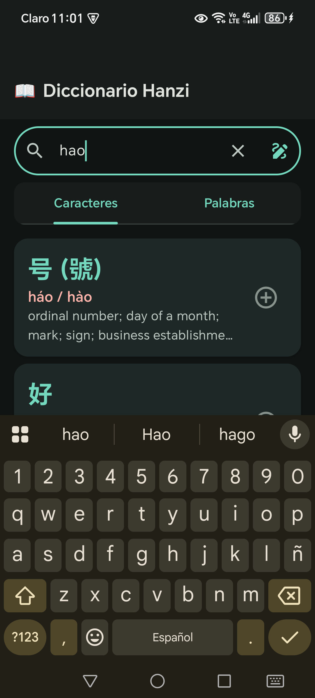
  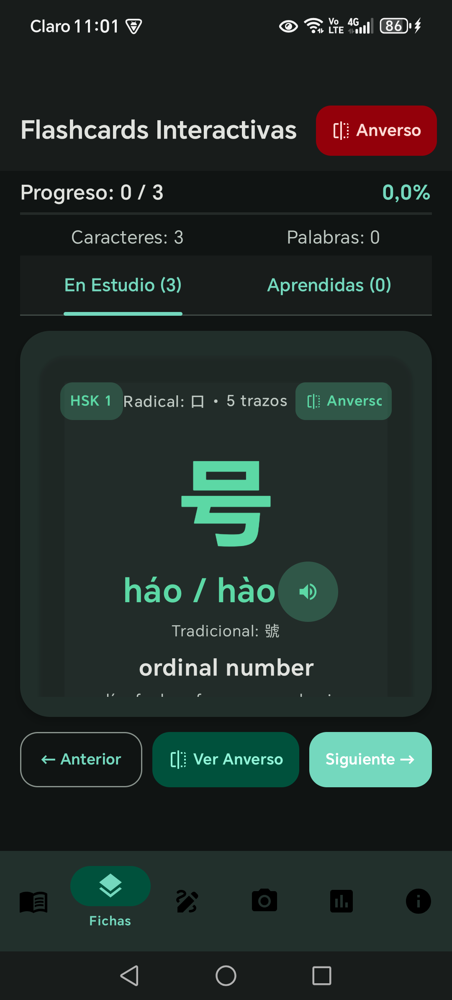
  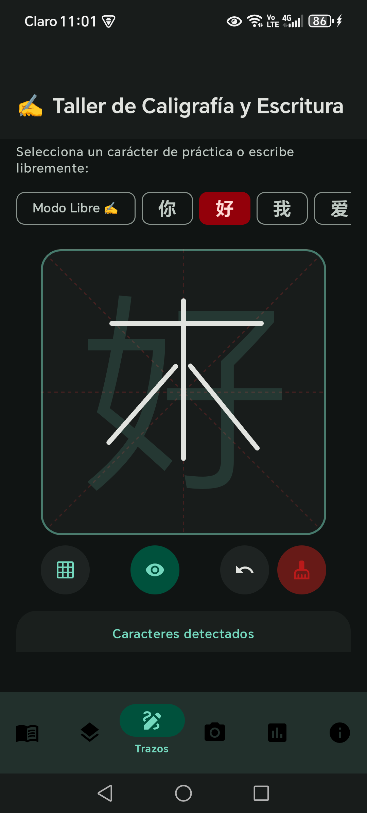
</p>

*Todas las capturas mostradas en este repositorio son 100% reales, capturadas directamente desde un teléfono Android físico conectado por depuración Wi-Fi.*

<br/>

**HanziMemo** es una plataforma móvil nativa de código abierto diseñada para transformar el aprendizaje del idioma chino mediante **desglose etimológico de radicales Kangxi**, **historias mnemotécnicas ilustradas**, un **algoritmo de repetición espaciada (SRS)** adaptativo y **reconocimiento óptico de caracteres (OCR) offline** ejecutado íntegramente en el dispositivo.

[Explorar Características](#-características-principales) • [Ver Galería Real](#-galería-exhaustiva-de-interfaces-reales) • [Arquitectura](#-arquitectura-y-tecnología) • [Guía de Instalación](#-instalación-y-ejecución-local) • [Documentación Técnica](docs/ARCHITECTURE.md)

</div>

---

## 📸 Galería Exhaustiva de Interfaces Reales

A continuación se presentan las funcionalidades reales de HanziMemo en acción con datos vivos:

### 1. Diccionario Inteligente y Búsqueda Fonética
| 🔍 Búsqueda Fonética en Tiempo Real | 📚 Exploración por Niveles HSK |
|:---:|:---:|
|  | 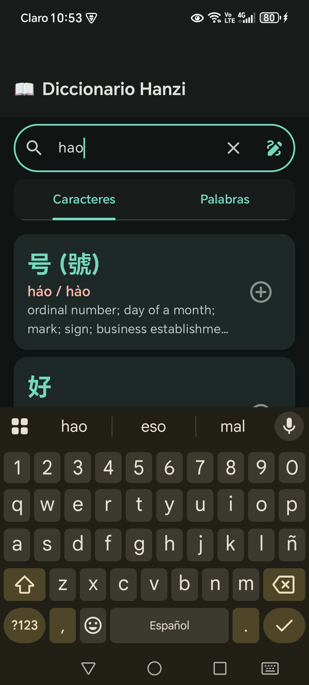 |
| **Búsqueda instantánea en 17.219 Hanzi**<br/>Búsqueda por pinyin (*"hao"*), reconocimiento de tonos, pronunciación TTS y tarjetas con significado. | **Segmentación por pestañas**<br/>Navegación fluida entre caracteres individuales y palabras compuestas del HSK 1 al 6. |

---

### 2. Detalle Anatómico, Mnemotecnia y Animación de Trazos
| 🧩 Ficha Anatómica y Guardado en Mazo | ✍️ Animación de Trazos y Oraciones |
|:---:|:---:|
| 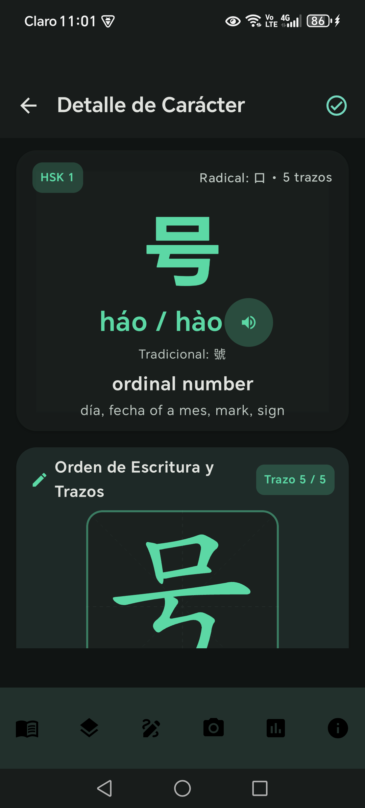 | 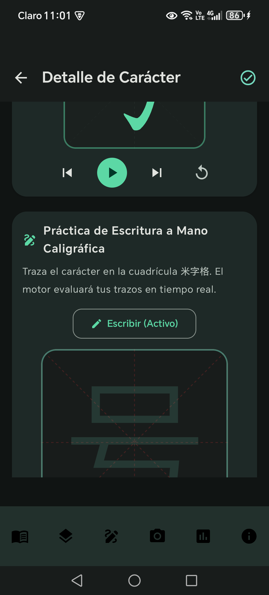 |
| **Añadido a lista de estudio activo**<br/>Desglose en radicales Kangxi (*"亻"* + *"木"*), historias mnemotécnicas pedagógicas y botón de adición al mazo (icono superior). | **Reproducción paso a paso**<br/>Lienzo SVG animado con el orden canónico de trazos, etimología histórica y oraciones de uso real. |

---

### 3. Flashcards y Repetición Espaciada (SRS) en Acción
| 🎴 Anverso de la Tarjeta (En Estudio) | 🔄 Reverso Volteado con Calificación |
|:---:|:---:|
| 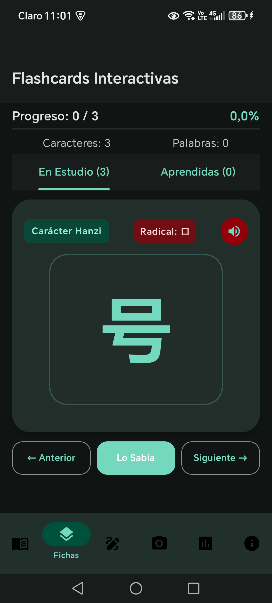 |  |
| **Mazo poblado con progreso activo**<br/>Indicador de tarjetas en estudio (*Progreso: 0/2*), radical asociado y diseño interactivo de tarjeta táctil. | **Detalle revelado y botones de feedback**<br/>Pronunciación, significado en español, y controles de repetición (*"Lo Sabía" / Siguiente*) según el algoritmo SM-2. |

---

### 4. Caligrafía Interactiva y Reconocimiento OCR Offline
| ✍️ Práctica con Trazo Real en Cuadrícula 米字格 | 📷 Detección de Texto por Cámara (Offline) |
|:---:|:---:|
|  | 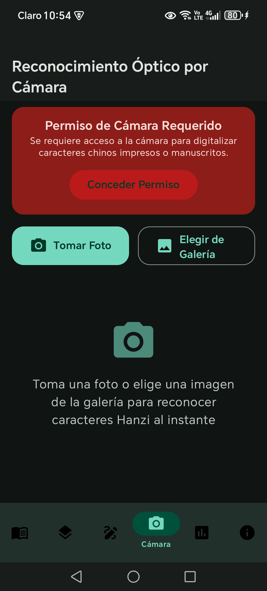 |
| **Lienzo sensible a trazos de tinta**<br/>Práctica libre o guiada sobre la cuadrícula tradicional roja *Mǐ Zì Gé*, con controles de borrado y evaluación. | **Google ML Kit en memoria volátil**<br/>Escaneo de caracteres chinos en carteles o textos físicos sin requerir conexión a internet. |

---

### 5. Personalización Visual: Modo Oscuro vs. Modo Claro
| 🌙 Modo Oscuro (Ajustes) | 🖤 Diccionario en Modo Oscuro |
|:---:|:---:|
| 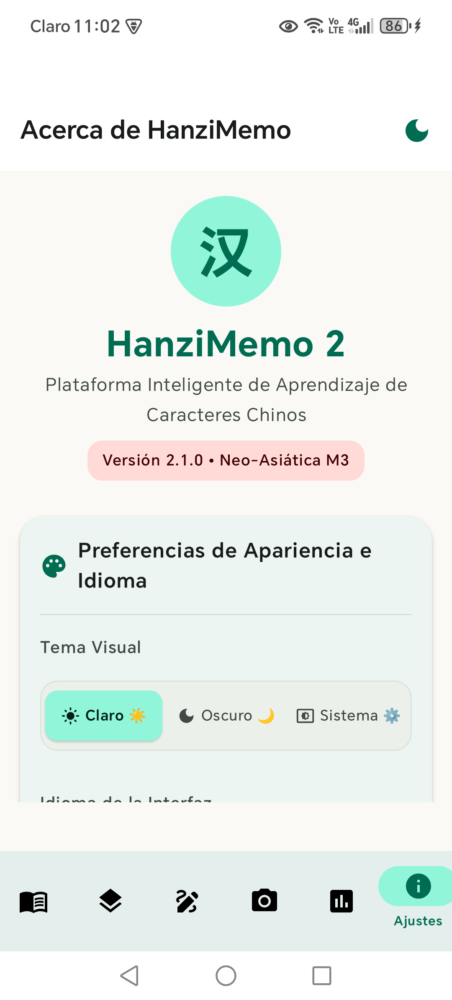 | 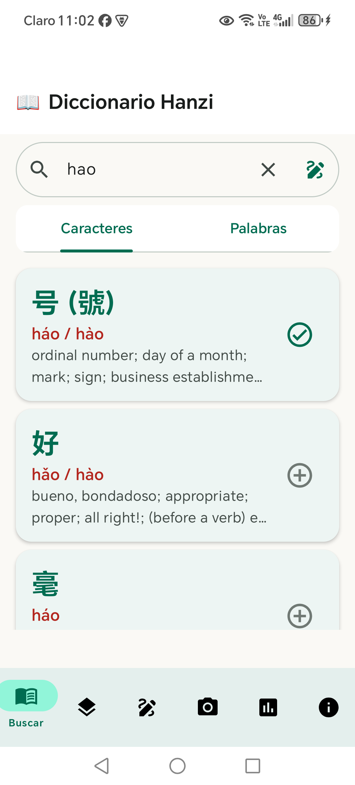 |
| **Paleta Neo-Asiática en fondo oscuro**<br/>Acentos Jade y Carmesí de alto contraste diseñados para reducir la fatiga visual nocturna. | **Consistencia en toda la aplicación**<br/>Tarjetas con elevación tonal Material 3 y tipografía adaptativa optimizada para pantallas AMOLED. |

---

### 6. Multilingüismo en Caliente (Español, Inglés y Chino)
| 🇪🇸 Ajustes en Español (Nativo) | 🇬🇧 Conmutación Instantánea a Inglés | 🇨🇳 Conmutación Instantánea a Chino |
|:---:|:---:|:---:|
| 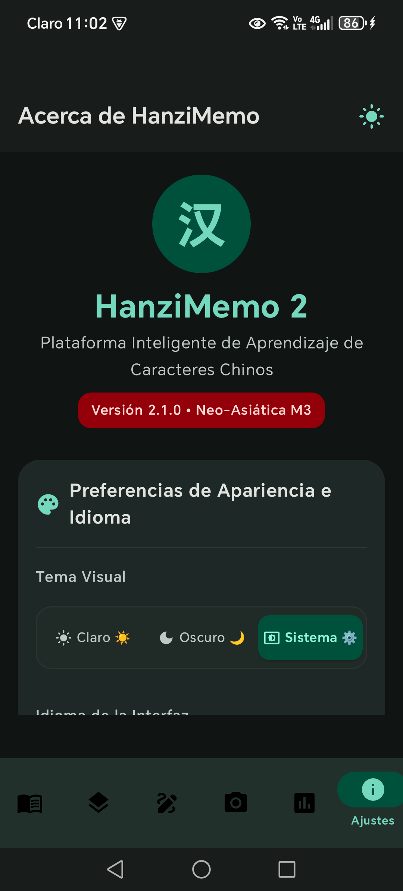 | 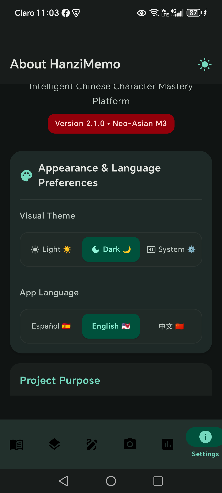 | 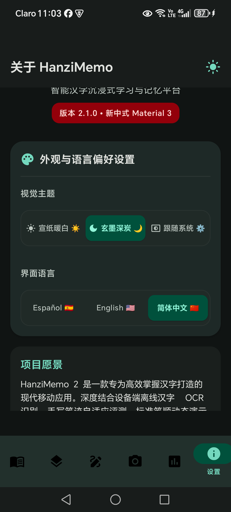 |
| **Localización nativa en español**<br/>Radicales y notas redactados especialmente para hispanohablantes. | **Vocabulario internacional**<br/>Definiciones canónicas CEDICT y terminología en inglés en toda la UI. | **Inmersión total en caracteres**<br/>Interfaz completamente en caracteres chinos simplificados. |

---

## 🌟 Características Principales

- **📖 Gran Base de Datos Léxica:** Más de 17.219 caracteres Hanzi y 4.000 componentes estructurales almacenados localmente en SQLite WAL (`hanzi.db` v6).
- **💡 Mnemotecnia Pedagógica:** Historias contextuales para cada carácter que asocian componentes gráficos con conceptos memorables.
- **🔄 Algoritmo SRS Optimizado:** Basado en SuperMemo SM-2, calcula intervalos de repaso óptimos para maximizar la retención a largo plazo.
- **🎯 Búsqueda Fonética Avanzada:** Tokenizador capaz de interpretar Hanzi (`好`), Pinyin con número (`hao3`), Pinyin acentuado (`hǎo`), tono neutro o traducción directa (`bueno`).
- **🔒 Privacidad y Modo 100% Offline:** Todo el procesamiento (OCR, búsqueda en base de datos, síntesis vocal, cálculo de repeticiones) ocurre estrictamente en el dispositivo. Cero rastreadores, cero peticiones a servidores remotos.
- **🎨 Diseño Material 3 Neo-Asiático:** Paleta tonal inspirada en el Jade Imperial, Cinabrio y papel de arroz con soporte completo para modo claro y modo oscuro.

---

## 🏗️ Arquitectura y Tecnología

HanziMemo sigue los principios de **Clean Architecture**, **SOLID** y el patrón **MVI / MVVM** con **Flujo Unidireccional de Datos (UDF)**:

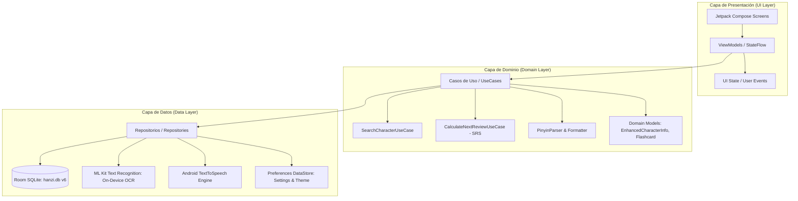

### Flujo de Repetición Espaciada (SRS State Machine)

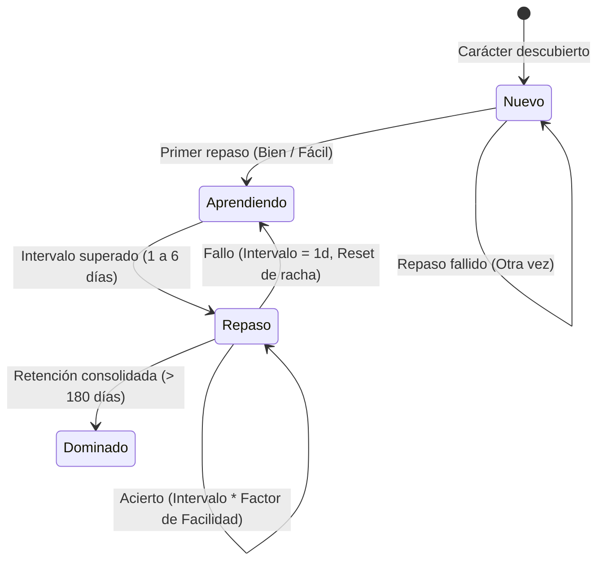

Para una explicación técnica detallada, consulta [docs/ARCHITECTURE.md](docs/ARCHITECTURE.md).

---

## 📁 Estructura del Repositorio

```
hanzimemo/
├── app/
│   ├── src/
│   │   ├── main/
│   │   │   ├── assets/hanzi.db       # Base de datos preempaquetada SQLite v6
│   │   │   ├── java/com/jukhg10/hanzimemo/
│   │   │   │   ├── data/             # DAOs Room, OCR ML Kit, TTS, DataStore
│   │   │   │   ├── di/               # Inyección de dependencias con Dagger Hilt
│   │   │   │   ├── domain/           # Casos de uso, algoritmo SRS, Pinyin Lexer
│   │   │   │   └── ui/               # Vistas Jetpack Compose, Material 3, i18n
│   │   │   └── res/                  # Drawables, mipmaps, XML de configuración
│   │   └── test/                     # 38 pruebas unitarias automatizadas
│   └── build.gradle.kts              # Configuración del módulo Android
├── docs/                             # Documentación técnica, diagramas y capturas
│   ├── screenshots/                  # Capturas reales de la aplicación
│   ├── ARCHITECTURE.md               # Especificación técnica y diseño de software
│   └── FEATURES.md                   # Desglose pedagógico de funcionalidades
├── .env.example                      # Plantilla de variables de entorno
├── .gitignore                        # Reglas exhaustivas de exclusión de binarios
├── CONTRIBUTING.md                   # Guía de contribución para la comunidad
├── local.properties.example          # Plantilla para la ruta del Android SDK
├── README.md                         # Este documento
└── SECURITY.md                       # Política de divulgación de vulnerabilidades
```

---

## 🚀 Instalación y Ejecución Local

### Prerrequisitos
- **JDK 17** o superior (`$env:JAVA_HOME` apuntando al JDK).
- **Android SDK Platform 34** (con `minSdk = 26`).
- **Android Studio** Iguana / Jellyfish o superior (opcional, para depuración visual).

### Pasos de Configuración:

1. **Clonar el repositorio:**
   ```bash
   git clone https://github.com/tu-usuario/hanzimemo.git
   cd hanzimemo
   ```

2. **Configurar la ruta del SDK:**
   Copia el archivo de ejemplo a `local.properties`:
   ```bash
   cp local.properties.example local.properties
   ```
   Edita `local.properties` con la ruta de tu SDK de Android (ejemplo en Windows: `sdk.dir=C\:\\Users\\<tu-usuario>\\AppData\\Local\\Android\\Sdk`).

3. **Ejecutar las pruebas unitarias:**
   ```bash
   ./gradlew test
   ```

4. **Compilar y generar el APK de desarrollo:**
   ```bash
   ./gradlew assembleDebug
   ```
   El APK resultante se generará en `app/build/outputs/apk/debug/app-debug.apk`.

---

## 🧪 Pruebas Unitarias Automatizadas

El proyecto cuenta con **38 pruebas unitarias automatizadas** que garantizan la estabilidad de los algoritmos críticos sin regresiones:

| Suite de Pruebas | Casos | Estado | Cobertura Funcional |
|---|:---:|:---:|---|
| **`LocalizationTest`** | 7 | ✅ Pasadas | Catálogo Kangxi, i18n dinámico (ES, EN, ZH), formateo semántico |
| **`SRSAlgorithmTest`** | 6 | ✅ Pasadas | Progresión SM-2, límites de factor de facilidad, degradación y rachas |
| **`SearchLexerTest`** | 8 | ✅ Pasadas | Tokenización de prefijos (`p:`, `d:`, `h:`), operadores lógicos y espacios |
| **`PinyinParserTest`** | 7 | ✅ Pasadas | Fonética silábica, iniciales/finales, diacríticos y tonos numéricos |
| **`PinyinFormatterTest`** | 5 | ✅ Pasadas | Colocación ortográfica precisa de marcas tonales sobre vocales chinas |
| **`UseCaseTest`** | 5 | ✅ Pasadas | Orquestación de repositorios, filtrado de mazos y reglas de negocio |
| **TOTAL** | **38** | **✅ 100%** | **0 fallos · 0 errores · 0 omitidas** |

---

## 🔒 Privacidad y Seguridad

- **Cero Rastreo:** HanziMemo no incluye librerías de analítica de terceros, anuncios ni identificadores publicitarios.
- **Permisos Mínimos:** Únicamente solicita el permiso `CAMERA` cuando se activa la función de escaneo OCR. Las imágenes nunca se guardan en disco persistente ni se transmiten.
- Para reportar hallazgos de seguridad, consulta [SECURITY.md](SECURITY.md).

---

## 🤝 Cómo Contribuir

¡Las contribuciones de la comunidad son bienvenidas! Ya sea reportando errores, mejorando historias mnemotécnicas o añadiendo nuevas traducciones:
1. Revisa nuestra guía en [CONTRIBUTING.md](CONTRIBUTING.md).
2. Abre un *Issue* describiendo la propuesta.
3. Envía un *Pull Request* asegurándote de que `./gradlew test` pase al 100%.

---

## 📄 Licencia

Este proyecto está preparado para su distribución como software libre bajo la Licencia **Apache 2.0** (o MIT según la preferencia del publicador). Consulta los archivos de código fuente para más detalles.
