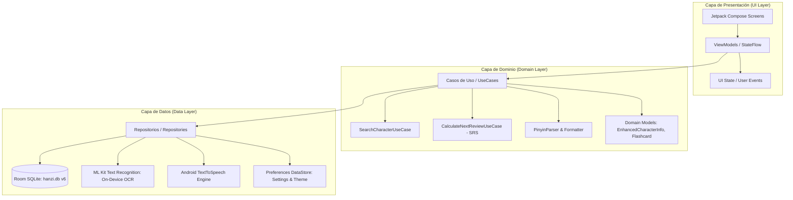
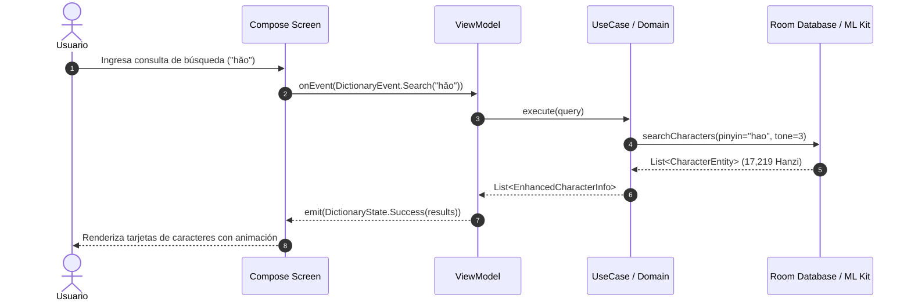
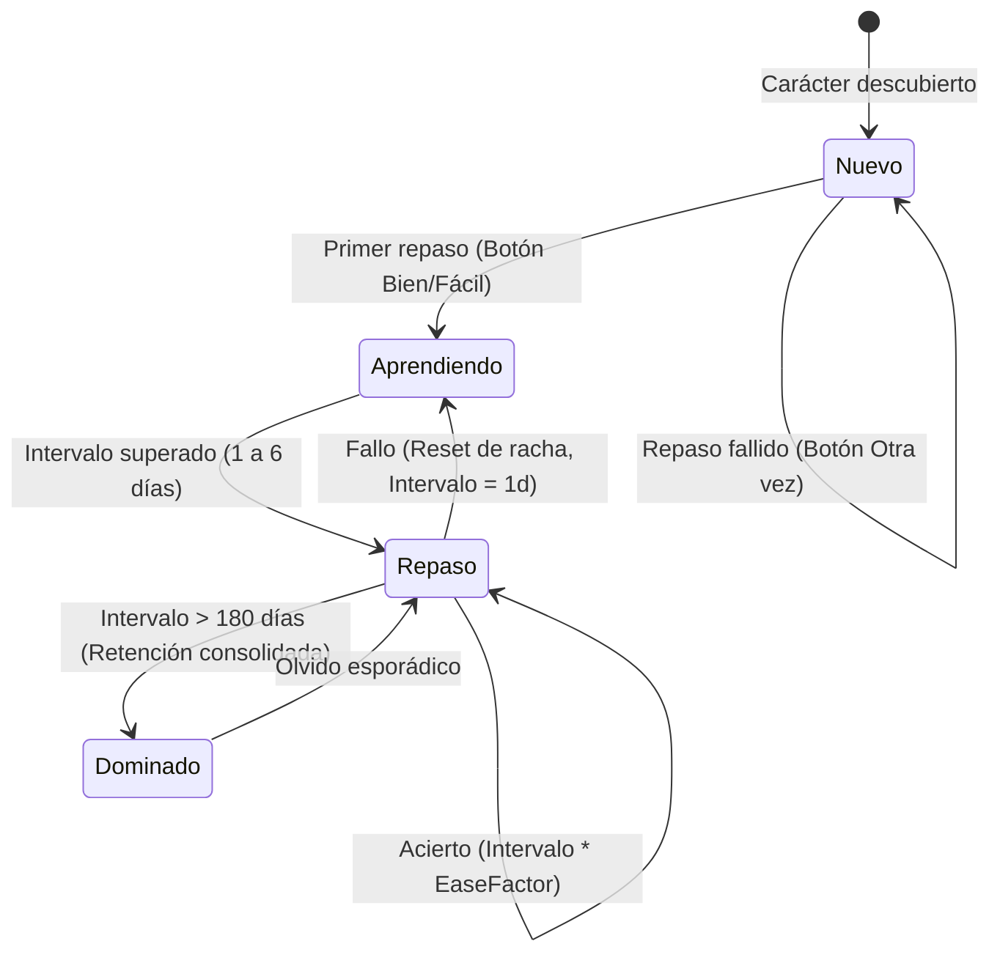

# Arquitectura del Sistema - HanziMemo (汉字Memo)

Este documento detalla la arquitectura técnica, patrones de diseño, estructura de módulos y flujo de datos de **HanziMemo**, una aplicación Android nativa moderna construida con **Kotlin**, **Jetpack Compose** y los principios de **Clean Architecture**.

---

## 1. Visión General de la Arquitectura

HanziMemo implementa una arquitectura por capas desacoplada basada en las directrices oficiales de Google para Android moderno, integrando el patrón **MVI / MVVM** con **Flujo Unidireccional de Datos (UDF)**.

---

## 2. Flujo Unidireccional de Datos (UDF)

Para garantizar un estado predecible y evitar condiciones de carrera, cada pantalla en Jetpack Compose se suscribe a un `StateFlow<UiState>` inmutable expuesto por su respectivo `ViewModel`:

---

## 3. Desglose de Capas

### 3.1 Capa de Presentación (`ui`)
- **Jetpack Compose & Material 3:** Declarativa, reactiva y totalmente adaptativa con soporte de modo claro y oscuro (`Theme.kt`, `Color.kt`).
- **Navegación (`AppNavigation.kt`, `Routes.kt`):** Sistema de enrutamiento basado en rutas seguras (`Routes.Dictionary`, `Routes.Flashcards`, `Routes.Calligraphy`, `Routes.Camera`, `Routes.Progress`, `Routes.About`).
- **Localización Dinámica (`Localization.kt`, `RadicalL10nData.kt`):** Sistema multilingüe nativo que conmuta en caliente entre Español, Inglés y Chino tradicional/simplificado.

### 3.2 Capa de Dominio (`domain`)
- **Casos de Uso:** Encapsulan reglas de negocio puras sin dependencias del SDK de Android.
- **Algoritmo SRS (`SRSAlgorithm.kt`):** Implementación mejorada del algoritmo SM-2/Leitner para repetición espaciada:
  - Intervalos adaptativos: 1 día, 6 días y cálculo exponencial con factor de facilidad (Ease Factor $EF \ge 1.3$).
  - Gestión de estados: *Nuevo*, *En Aprendizaje*, *Para Repasar*, *Dominado*.
- **Pinyin Lexer & Parser (`PinyinParser.kt`, `PinyinFormatter.kt`):** Análisis léxico y conversión bidireccional entre pinyin con números (`hao3`) y pinyin con marcas tonales (`hǎo`), con soporte para tono neutro y combinaciones múltiples.

### 3.3 Capa de Datos (`data`)
- **Room Database (`AppDatabase.kt`, versión 6):**
  - Preempaquetada en `assets/hanzi.db` con 17,219 caracteres Hanzi, etimologías, trazos y vocabulario.
  - Entidades indexadas para búsquedas sub-milisegundo en `CharacterDao`, `WordDao` y `StudyDao`.
- **Reconocimiento Óptico (OCR) Offline (`HanziRecognitionService.kt`):**
  - Impulsado por **Google ML Kit Text Recognition (Chinese)** ejecutado estrictamente en dispositivo (NPU/GPU/CPU).
  - Privacidad total: ningún dato visual sale del dispositivo del usuario.
- **Audio y Síntesis Vocal (`TextToSpeechManager.kt`):**
  - Motor TextToSpeech nativo de Android configurado para mandarín estándar (`Locale.CHINESE`).
- **Inyección de Dependencias (Dagger Hilt):**
  - Módulos `DatabaseModule` y `AppModule` para proveer instancias singleton de repositorios, DAOs y servicios.

---

## 4. Ciclo de Vida del Algoritmo de Repetición Espaciada (SRS)

---

## 5. Estrategia de Pruebas Automatizadas

La arquitectura permite una separación estricta que facilita las pruebas unitarias sin mocks complejos del framework Android:
- **Pruebas de Dominio:** Cobertura de parsers, formateadores, lexers y algoritmos matemáticos de repetición espaciada.
- **Pruebas de Localización:** Verificación del catálogo semántico de 214 radicales Kangxi y oraciones de ejemplo.
- **Métricas:** 38/38 pruebas unitarias automatizadas con ejecución en menos de 2 minutos.
