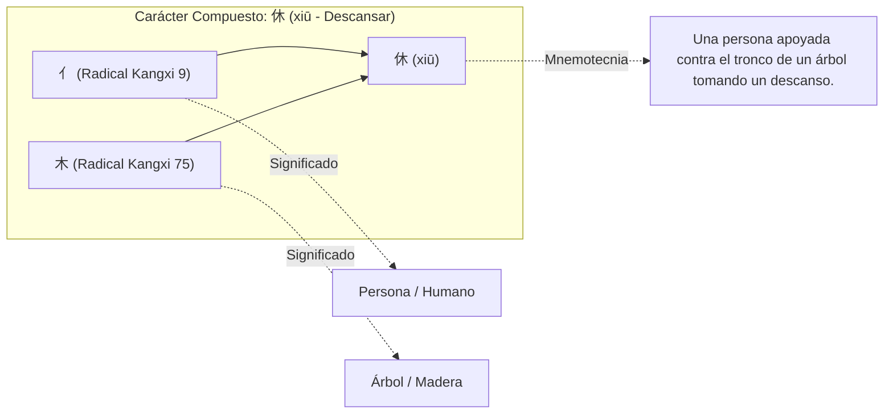

# Guía Visual y Funcional de Características - HanziMemo

HanziMemo combina pedagogía lingüística tradicional con tecnología móvil avanzada para hacer que el aprendizaje de caracteres chinos sea intuitivo, duradero y visualmente agradable.

---

## 📚 1. Diccionario Hanzi y Motor de Búsqueda Fonética

El diccionario de HanziMemo está respaldado por una base de datos local SQLite de alto rendimiento con **17,219 caracteres Hanzi** y más de **4,000 componentes etimológicos**.

```
┌────────────────────────────────────────────────────────┐
│ 🔍 Buscar por Pinyin, Hanzi o Significado: "hao"       │
├────────────────────────────────────────────────────────┤
│ [Todos] [HSK 1] [HSK 2] [HSK 3] [HSK 4] [HSK 5] [HSK 6]│
├────────────────────────────────────────────────────────┤
│  好   hǎo [Tono 3]   [HSK 1]   🔊 [Escuchar]           │
│       Significado: bueno, bien, adecuado               │
│       Radical: 女 (mujer) | 6 trazos                   │
│       Palabras frecuentes: 你好 (hola), 好吃 (delicioso) │
└────────────────────────────────────────────────────────┘
```

### Capacidades Destacadas:
- **Búsqueda Flexible:** Búsqueda simultánea por carácter simplificado (`好`), tradicional (`好`), pinyin numérico (`hao3`), pinyin acentuado (`hǎo`), o traducción en español/inglés.
- **Filtros por Nivel HSK:** Segmentación instantánea según el estándar HSK 2.0 y HSK 3.0 (HSK 1 a HSK 6+).
- **Código de Color por Tono:**
  - Tono 1 (Plano): Rojo / Carmesí
  - Tono 2 (Ascendente): Ámbar / Amarillo
  - Tono 3 (Descendente-Ascendente): Verde / Esmeralda
  - Tono 4 (Descendente): Azul / Cobalto
  - Tono 5 (Neutro): Gris neutro

---

## 🧩 2. Desglose Etimológico e Historias Mnemotécnicas

Aprender un carácter como un simple dibujo de líneas arbitrarias produce una alta tasa de olvido. HanziMemo desglosa cada Hanzi en sus bloques constructivos fundamentales (Radicales Kangxi y componentes fonético-semánticos):



### Características Pedagógicas:
- **214 Radicales Kangxi Catalogados:** Con significado en Español, Inglés y Chino en `RadicalL10nData.kt`.
- **Evolución Histórica:** Notas sobre inscripciones oraculares en huesos (*Jiaguwen*), sellos de bronce (*Jinwen*) y evolución hasta la tipografía simplificada moderna.
- **Oraciones de Ejemplo Reales:** Frases en chino con pinyin interactivo y traducción contextualizada.

---

## 🗂️ 3. Sistema de Flashcards con Repetición Espaciada (SRS)

Basado en el algoritmo optimizado **SM-2** (SuperMemo 2), HanziMemo calcula dinámicamente el momento exacto en el que tu memoria está a punto de olvidar un carácter para presentártelo en el momento de mayor eficiencia neuronal.

### Los 4 Botones de Calificación:
| Botón | Intervalo Típico | Impacto en Algoritmo | Cuándo Seleccionarlo |
|---|---|---|---|
| **Otra vez** | < 10 minutos | Reinicia racha a 0, disminuye Ease Factor | Olvido completo del carácter |
| **Difícil** | 1 día | Incremento leve, reduce Ease Factor (-0.15) | Dudaste mucho o tardaste en recordar |
| **Bien** | 3 a 6 días | Multiplica por Ease Factor actual | Respuesta correcta con esfuerzo normal |
| **Fácil** | 7+ días | Multiplica por Ease Factor con bonificación (+0.15) | Recordado al instante sin vacilar |

---

## ✍️ 4. Práctica Caligráfica y Animación de Trazos

Aprender a escribir refuerza la memoria kinestésica y la precisión de reconocimiento:
- **Cuadrícula Tradicional 米字格 (Mi-Zi-Ge):** Guías visuales rojas proporcionales para centrado armónico del carácter.
- **Animación Paso a Paso:** Muestra visualmente la dirección de cada trazo según las reglas canónicas de la caligrafía china (*de arriba a abajo, de izquierda a derecha, de afuera hacia adentro*).
- **Lienzo de Dibujo Sensible:** Detección de trazos en pantalla con cálculo de coincidencia y feedback háptico.

---

## 📷 5. Reconocimiento Óptico de Caracteres (OCR) 100% Offline

Apunta la cámara de tu smartphone a cualquier texto en chino físico (carteles, libros, menús de restaurantes, productos) y obtén reconocimiento instantáneo sin conexión a internet.

```
┌────────────────────────────────────────────────────────┐
│ 📷 [Vista de Cámara en Tiempo Real]                    │
│   ┌───────────────────────────┐                        │
│   │  [北京烤鸭]                │ <--- Bounding box     │
│   └───────────────────────────┘                        │
├────────────────────────────────────────────────────────┤
│ 📍 Carácter Detectado: 烤 (kǎo)                        │
│    Pinyin: kǎo | Tono 3 | Radical: 火 (fuego)           │
│    Significado: Asar, tostar, hornear                  │
│    [🔊 Escuchar Pronunciación]  [➕ Guardar en Mazo]    │
└────────────────────────────────────────────────────────┘
```
- **Sin Consumo de Datos Móviles:** Impulsado por Google ML Kit en dispositivo.
- **Privacidad Absoluta:** Las imágenes no se transmiten a la nube ni se almacenan en servidores.

---

## 🌐 6. Multilingüismo en Caliente

HanziMemo cuenta con localización completa integrada para los siguientes idiomas:
- 🇪🇸 **Español (Nativo):** Definiciones adaptadas al español, notas pedagógicas y radicales Kangxi.
- 🇬🇧 **Inglés:** Definiciones canónicas CEDICT y terminología internacional.
- 🇨🇳 **Chino (Mandarín):** Nombres formales de radicales y descripciones gramaticales para estudiantes avanzados.
